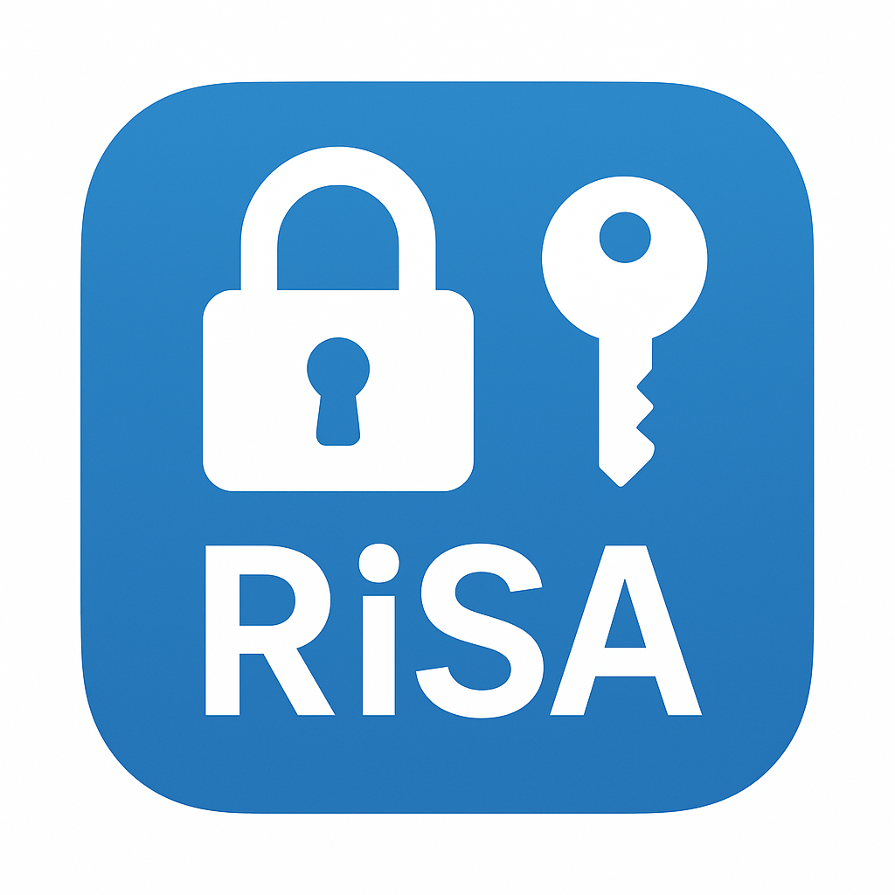

# 🔐 RiSA - RSA 암호화 데스크톱 앱

  

**민감한 데이터를 로컬에서 안전하게 암호화하는 오픈소스 데스크톱 앱**

RiSA는 암·복호화를 간단하게 만들면서도 키 값을 네트워크에 노출하지 않는 로컬 중심 철학을 바탕으로 설계되었습니다. 모든 데이터는 사용자 기기 안에서만 처리되며, 공개된 소스코드를 통해 누구나 그 과정을 확인할 수 있습니다.

---

## 🛡️ RiSA를 써야 하는 이유!

**로컬 중심 철학**: 암·복호화 전 과정을 로컬에서 수행하여 키 값을 어떤 네트워크에도 노출하지 않습니다.

**투명성과 신뢰**: 모든 소스코드를 공개해 언제든지 검증할 수 있도록 했으며, 숨겨진 백도어나 데이터 수집 우려가 없습니다.

**편리한 GUI**: 복잡한 명령어나 설정 없이 직관적인 그래픽 인터페이스로 강력한 RSA 암호화를 사용할 수 있습니다.

---

## 📥 다운로드 및 웹 체험

### 💻 RiSA Web

**[https://ri-sa.vercel.app/](https://ri-sa.vercel.app/)**

브라우저에서 주요 기능을 즉시 체험하고, 필요한 경우 화면 하단에 나타나는 다운로드 팝업에서 운영체제에 맞는 설치 파일을 바로 받을 수 있습니다.
_현재 MacOS 버전으로만 제공됩니다._

_최신 릴리즈는 [GitHub Releases](https://github.com/0-ROK/RiSA/releases/latest)에서도 확인할 수 있습니다._

---

## ✨ 주요 기능

### 🔒 **강력한 RSA 암호화**

- RSA-OAEP (권장) 및 RSA-PKCS1 알고리즘 지원
- 1024, 2048, 4096 비트 키 크기 선택 가능
- 안전한 키 생성, 관리, 가져오기/내보내기

### 🔗 **Chain Builder (연속 작업)**

- 여러 작업을 순차적으로 연결하여 실행
- URL 인코딩/디코딩, Base64 인코딩/디코딩
- RSA 암호화/복호화를 포함한 복합 워크플로우

### 🌐 **HTTP Parser (URL 템플릿)**

- URL 템플릿을 활용한 파싱 및 생성
- 경로 파라미터와 쿼리 파라미터 추출
- 재사용 가능한 템플릿 시스템

### 🎨 **직관적인 사용자 경험**

- 깔끔한 사이드바 네비게이션
- 작업 히스토리 자동 저장

---

## 🧭 탭별 기능 한눈에 보기

### 🏠 메인 탭

- 텍스트 암호화/복호화 작업을 빠르게 수행
- RSA-OAEP, RSA-PKCS1 등 알고리즘 선택 및 옵션 조정
- 입력 검증과 결과 미리보기를 통해 실수 예방

### 🔑 키 관리 탭

- 새로운 키 쌍 생성, 가져오기, 내보내기 지원
- 권장 키 길이 안내 및 키 별 메타데이터 관리
- 로컬 파일 시스템과 바로 연동되어 안전한 보관 가능

### 🧱 Chain Builder 탭

- 암호화, 디코딩, 인코딩 작업을 순서대로 연결하여 자동 실행
- 반복되는 작업을 템플릿으로 저장해 재사용
- URL/Base64 등 보조 유틸리티와 RSA 작업을 함께 구성

### 🌐 HTTP Parser 탭

- URL 템플릿을 기반으로 경로·쿼리 파라미터를 손쉽게 추출
- 파라미터 수정 후 재조합하여 결과 미리보기 제공
- 자주 사용하는 엔드포인트를 템플릿으로 저장하여 업무 효율성 향상

---

## 🧪 웹 환경 안내

설치 전이나 간단한 테스트가 필요할 때에는 웹 환경을 활용하세요.

- **[RiSA Web](https://ri-sa-kklc.vercel.app/)**: 실제 앱과 동일한 사용자 흐름을 체험하며 주요 탭과 기능을 탐색할 수 있습니다.
- 웹에서 작업하다가 로컬 설치가 필요하면 화면 하단의 다운로드 팝업에서 데스크톱 설치 파일을 받을 수 있습니다.
- 브라우저에서도 RSA 키 생성과 암·복호화를 체험할 수 있으며, 생성된 키는 로컬 스토리지에 안전하게 보관됩니다.
- 브라우저 로컬 스토리지에 저장된 데이터는 30일이 지나면 자동으로 삭제되어 장기 보관을 방지합니다.
- 팝업은 GitHub Releases의 최신 버전을 조회해 운영체제에 맞는 설치 파일 링크를 직접 제공합니다.
- macOS 사용자는 애플 실리콘과 인텔 아키텍처를 자동으로 감지해 올바른 설치 파일을 안내받습니다.
- 팝업은 닫아도 현재 방문 중에만 숨겨지며, 페이지를 다시 열면 자동으로 나타납니다.
- 데모는 체험용으로 제공되므로 실제 민감한 데이터는 로컬 앱에서 처리하는 것을 권장합니다.

---

## 🚀 빠른 시작

### 1️⃣ 설치

1. [RiSA Web](https://ri-sa-kklc.vercel.app/) 화면 하단 다운로드 팝업에서 운영체제에 맞는 설치 파일을 다운로드
2. DMG 마운트 (macOS)

### 2️⃣ 키 생성

1. 앱 실행 후 **키 관리** 탭으로 이동
2. **새 키 생성** 버튼 클릭
3. 키 크기 선택 (권장: 2048비트 이상)
4. 키 이름 입력 후 생성

### 3️⃣ 암호화/복호화

1. **메인** 탭에서 작업 선택 (암호화/복호화)
2. 텍스트 입력 및 키 선택
3. 알고리즘 선택 (권장: RSA-OAEP)
4. **실행** 버튼 클릭

---

## 🛡️ 보안 정보

### 지원 알고리즘

- **RSA-OAEP** ⭐ (권장): 최신 보안 표준, OAEP 패딩 사용
- **RSA-PKCS1**: 호환성을 위한 기존 표준 (보안 위험 있음)

### 권장 사항

- **키 크기**: 2048비트 이상 사용 (4096비트 권장)
- **알고리즘**: RSA-OAEP 사용
- **키 관리**: 개인키는 안전한 곳에 보관

### 신뢰할 수 있는 다운로드

- ✅ **오픈소스**: 모든 코드는 GitHub에서 공개적으로 검증 가능
- ✅ **자동 빌드**: GitHub Actions로 자동 빌드되어 변조 불가능
- ✅ **MIT 라이선스**: 자유롭게 사용, 수정, 배포 가능

---

## 🔄 자동 업데이트

RiSA는 자동 업데이트를 지원합니다:

- 새 버전 출시 시 앱 내 알림
- 백그라운드 다운로드
- 원클릭 설치 및 재시작

---

## 📄 라이선스

이 프로젝트는 [MIT 라이선스](LICENSE) 하에 배포됩니다.

---

## 💬 지원

문제가 있거나 기능 제안이 있으시면 [GitHub Issues](https://github.com/0-ROK/RiSA/issues)에서 알려주세요.

---

  
<strong>RiSA와 함께 안전한 암호화를 경험하세요! 🔐</strong>

  
  [다운로드](https://ri-sa-kklc.vercel.app/) • [릴리즈 노트](https://github.com/0-ROK/RiSA/releases) • [문제 신고](https://github.com/0-ROK/RiSA/issues)

